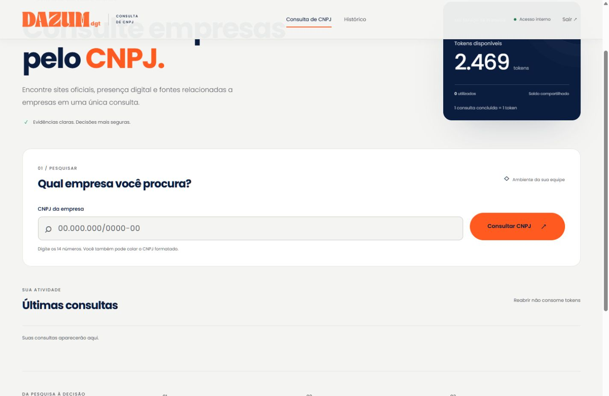

# DazumDigital · Consulta de CNPJ

Plataforma web interna que organiza sites oficiais, verificações manuais, possíveis sites, redes sociais e referências empresariais. Reaproveita o motor Python da POC e os vinte resultados históricos, com saldo comercial persistente e separado das cotas dos provedores.

**Situação:** aplicação local funcional; pesquisas externas desativadas por padrão. Produção depende de PostgreSQL, usuários, configuração de hospedagem e validação em Preview. Nenhum deploy ou consulta externa faz parte dos testes.



[Prévia mobile](docs/screenshots/mobile-oficial.jpg)

## Tecnologias e estrutura

- Python 3.12+; ambiente validado com Python 3.14 no Windows.
- FastAPI, SQLAlchemy 2, PostgreSQL/psycopg ou SQLite para uso local.
- HTML, CSS e JavaScript nativos; sem framework frontend ou build Node obrigatório.
- Poppins local, SVGs oficiais e favicon fornecidos pela DazumDigital.
- Motor original: httpx, SQLite, cotas compartilhadas, cache, SSRF e exportação CSV/JSON/Excel.

```text
app/web/api.py             API, sessão e arquivos estáticos
app/web/store.py           saldo, transações, idempotência e fila persistente
app/web/auth.py            contas da equipe e sessões
app/web/results.py         contrato público dos resultados
app/web/migrate.py         importação idempotente e auditável dos vinte registros
app/web/engine.py          adaptador explícito ao motor existente
app/web/manage.py          administração local e executor autorizado
app/web/static/            interface, tokens da marca, logos, fonte e favicon
app/providers/            integrações originais
app/services/             descoberta, classificação, SSRF e cotas originais
app/storage/              histórico e checkpoints CLI originais
tests/                    testes offline e fixtures
docs/PLATAFORMA_WEB.md     operação, arquitetura, segurança e Vercel
var/                      banco web e novos checkpoints locais; fora do Git
data/                     bancos e resultados históricos locais; fora do Git
```

## Executar no VS Code

Na pasta do projeto, terminal PowerShell:

```powershell
# Se ainda não existir um ambiente virtual:
python -m venv .venv
.\.venv\Scripts\python.exe -m pip install -r requirements.txt
.\.venv\Scripts\python.exe -m pip install -e '.[dev,web,webtest]'
if (-not (Test-Path -LiteralPath '.env.web')) {
    Copy-Item -LiteralPath '.env.web.example' -Destination '.env.web'
}
.\.venv\Scripts\python.exe -m app.web.manage init
.\.venv\Scripts\python.exe -m app.web.manage import 'data/output/consolidacao20-oficial-2026-11-04/consolidacao20.sqlite'
.\.venv\Scripts\python.exe -m app.web.manage create-user seu.usuario
.\.venv\Scripts\python.exe -m uvicorn app.web.api:app --env-file .env.web --host 127.0.0.1 --port 8000
```

Abra **http://127.0.0.1:8000** e entre com a conta criada. A senha é solicitada de forma oculta no terminal; não há senha padrão. `create-user` é executado uma vez por usuário. `init`/`import` podem ser repetidos sem reiniciar o saldo. Os bancos históricos não são incluídos no repositório: em um clone novo, disponibilize a consolidação local antes de importá-la.

No Linux, use `python3 -m venv .venv` e `.venv/bin/python` nos comandos equivalentes. O código e as dependências foram preparados para Linux, mas o runtime Linux/Preview ainda exige validação no ambiente final.

## Saldo e consultas

O saldo inicial compartilhado da organização é **2.469 tokens**. Uma nova consulta concluída consome um token, inclusive quando usa dados armazenados ou não encontra resultados. CNPJ inválido e falha interna não consomem token. Reabrir uma consulta e recarregar a página não geram nova cobrança.

O backend grava resultado, desconto e lançamento contábil na mesma transação. Chaves de idempotência e restrições únicas impedem descontos duplicados. Locks em SQLite/PostgreSQL protegem acessos simultâneos. A inicialização não sobrescreve saldos existentes; deploy não executa inicialização automaticamente.

**Tokens comerciais não são créditos do provedor.** Cotas técnicas, saldo gratuito confirmado, custo adicional zero e bloqueios operacionais continuam independentes. A plataforma não libera pesquisas adicionais nem aumenta tetos por causa do saldo comercial.

## Resultados e dados reais

- Daiju (`00065589000106`): confirmação automática baseada em evidências institucionais armazenadas.
- THP (`00055627000140`): verificação manual informada, sem promoção a confirmação automática.
- Softdata (`00056678000196`): candidato pendente, sem Website oficial confirmado.
- Boschetti (`00068581000101`): referências úteis de terceiros; FarmBy tem ressalva de município e confiança BAIXA.
- Kobarg (`00064909000103`): sem site oficial ou referências selecionadas.

As referências podem ser úteis sem representar titularidade. Diretórios não preenchem Website oficial. URLs genéricas, inscrições divergentes e perfis pessoais sem marca correspondente não são apresentados como sites/perfis empresariais confirmados. Disponibilidade atual de links históricos não é inventada.

## Testes e build

```powershell
.\.venv\Scripts\python.exe -m pytest -q
node --test tests/web_core.test.mjs
node --check app/web/static/app.js
.\.venv\Scripts\python.exe -m app.web.build
.\.venv\Scripts\python.exe -m pip wheel --no-deps --wheel-dir dist .
```

Node é opcional para executar a aplicação; é utilizado nos testes da lógica do frontend. A suíte Python bloqueia conexões/DNS e usa mocks para integrações. Há testes de segurança, importação, classificação, transações, concorrência, persistência e identidade visual. O build valida os dezesseis assets e gera um manifesto local. O wheel inclui logos, Poppins, sua licença e favicon.

## Motor CLI e segurança

O motor original continua em `app.main`, `app.pilot3`, `app.new_batch`, `app.review_saved` e `app.consolidate`. Não houve reescrita do algoritmo. Configuração técnica pode ser inspecionada sem consultas:

```powershell
.\.venv\Scripts\python.exe -m app.main --check-config
```

O adaptador web de novas pesquisas é executado apenas por comando administrativo explícito, com fila persistente, uma empresa por vez, validação documental e cotas compartilhadas. Fica desativado nesta entrega. Consulte [o guia operacional](docs/PLATAFORMA_WEB.md) antes de qualquer liberação.

Não envie `.env`, credenciais, manifestos ativos, bancos SQLite, dados de entrada, resultados privados, logs ou ambientes virtuais ao GitHub/Vercel. `.env.web.example` e `.env.example` contêm apenas modelos. Há autenticação no backend, cookies HttpOnly, CSRF, validação de origem/host, SQL parametrizado, CSP, URLs sanitizadas e proteções de SSRF preservadas no motor.

## Preparação Vercel

O entrypoint é `app.web.api:app`; `pyproject.toml`, `.python-version`, `requirements.txt`, `vercel.json` e `.vercelignore` estão preparados. O frontend é servido pela aplicação e seus assets são promovidos pelo suporte FastAPI da Vercel.

Deploys automáticos por Git estão desativados em `vercel.json`; enviar uma branch para revisão não publica a aplicação.

Produção exige **PostgreSQL persistente**; SQLite mutável é bloqueado fora do modo local. Um banco Neon Free pode ser avaliado sem contratação automática. O banco, suas credenciais, o domínio, os usuários e a validação Linux/Preview ainda precisam ser configurados explicitamente.

O plano Vercel Hobby permite uso pessoal não comercial. Não presumir que a plataforma empresarial pode operar nele gratuitamente: a condição de hospedagem/custo precisa ser resolvida antes da publicação. Nenhum plano pago, recarga, merge ou deploy de produção é ativado pelo projeto.

Veja [PLATAFORMA_WEB.md](docs/PLATAFORMA_WEB.md) para comandos completos, limites, inicialização, migração, autenticação, recuperação e passos futuros de Preview. Consulte também [o guia CLI](docs/CLI.md). Os relatórios e o README histórico da POC permanecem preservados localmente; seus números de testes e estágios não descrevem a entrega web atual.
